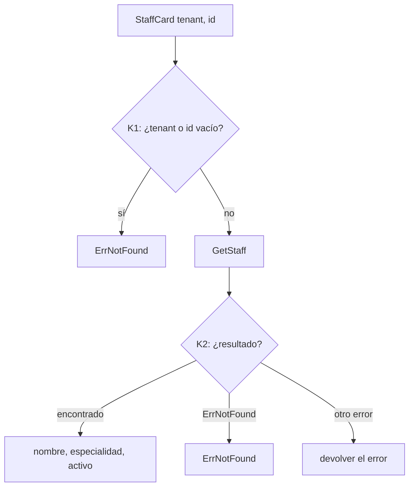

# `StaffCard` — lo mínimo y público de un profesional

Cada rombo lleva un id; [`docs/PLAN.md`](../PLAN.md) §3 asigna a cada rama su prueba.

Nunca devuelve RUT, usuario, dispositivos ni contacto: lo consume una reserva online pública.
